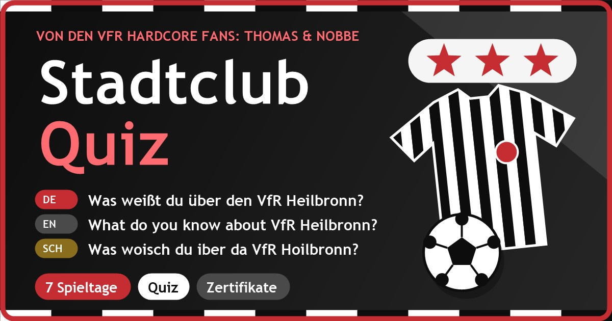

**⚽ Live ansehen: [https://nosz.github.io/vfr-heilbronn](https://nosz.github.io/vfr-heilbronn)**

# VFRHEILBRONN: Stadtclub-Quiz

**Von den VfR Hardcore Fans: Thomas & Nobbe** (inoffizielles Fan-Projekt zu https://www.vfr1896.de/)

**Datei:** `index.html` (eine Datei, offline lauffähig, Version 1.3.0, Stand 14.10.2026). Einfach im Browser öffnen oder auf einem Webserver ablegen.

> **Veröffentlichung:** GitHub-Repository `vfr-heilbronn` unter dem Benutzer `nosz`, also `https://nosz.github.io/vfr-heilbronn/`. Alle Dateien (inklusive Icons im Hauptordner) gehören direkt in die Wurzel des Repositories.

## Inhalt
Fan-Quiz mit 7 Spieltagen, viel Humor, Zertifikaten und Personalisierung, in **Deutsch, Englisch und Schwäbisch** (Umschalter oben, wird gespeichert).

| Nr. | Spieltag | Fragen |
|---|---|---|
| 1 | Blitzstart: 1896 in 60 Sekunden | 2 |
| 2 | Die große Zeit: Zweite Liga | 2 |
| 3 | Pokalnacht 1970: Offenbach muss zittern | 4 |
| 4 | Talentschmiede: Jugend-Pokal 1996 | 4 |
| 5 | Köpfe: Rangnick, Čajkovski & Co. | 4 |
| 6 | Neustart 2018: Von der Kreisliga B bis zur Verbandsliga | 4 |
| 7 | Bossrunde: Elfmeterschießen | 5 |

- **Hinweis ganz oben:** In der Kopfzeile direkt unter "Stadtclub-Quiz" steht groß und fett: "von den VfR Hardcore Fans: Thomas & Nobbe" (Deutsch, Englisch, Schwäbisch), ebenso auf jedem Zertifikat und in der Fußzeile.
- **Stammtisch-Spruch & Fakt:** Karte auf der Startseite mit 15 Sprüchen und Fakten (Gags von Thomas & Nobbe plus belegte Zahlen aus den Quellen), Knopf "Noch einer!".
- **Startseite:** Name optional, nur lokal gespeichert, steckt in Begrüßung, Quiz, Ergebnis und Zertifikat. Zwei Wege ("Ich bin neu im Stadion" / "Ich bin schon ewig Fan").
- **Spielmechanik:** 10 Tore je richtiger Antwort, 1 bis 3 Sterne je Spieltag, 5 Ränge von "Bankdrücker" bis "Vereinslegende", Konfetti, Hell- und Dunkelmodus.
- **Zertifikate:** je Spieltag ein "Stadtclub-Zertifikat", zum Abschluss das "Meister-Zertifikat" (PNG speichern oder drucken), unterschrieben "Thomas & Nobbe (inoffiziell)".
- **PWA:** installierbar, läuft offline, Update-Hinweis. Dateien (alle ins Hauptverzeichnis): `index.html`, `manifest.webmanifest`, `sw.js`, `icon-192.png`, `icon-512.png`, `icon-maskable-512.png`, `favicon.png`, `favicon.svg`, `apple-touch-icon.png`, `vfrheilbronn_vorschau.jpg`. Bei jeder neuen Version `VERSION` in `index.html` **und** `sw.js` gemeinsam erhöhen.

## Marke und Look
Farben aus einem Screenshot von vfr1896.de gemessen (Pixelwerte): Kopfbereich `#0D0D0D`, Hero `#1A1A1A`, Hintergrund `#F5F5F5`, Knopf `#3A3A3A`, Rot der Grafiken `#D33C3E` (für guten Kontrast auf `#C62D33` abgedunkelt). Es werden **kein Vereinswappen, keine Logos, keine Spielerfotos und keine kopierten Texte** verwendet. Das Logo ist ein selbst gezeichnetes Pixel-Trikot in Schwarz-Weiß mit dem Schriftzug "VFR" auf der Brust und einer Neckar-Welle darunter. Das Vorschaubild zeigt (ohne Sterne) ein gestreiftes Trikot mit "VFR", eine selbst gezeichnete Käthchen-Figur mit Fußball, den Neckar als Wellenband und den Schriftzug "Käthchenstadt am Neckar". Heilbronn-Bezug laut Wikipedia: Die Stadt liegt am Neckar und wird auch "Käthchenstadt" genannt (nach Kleists Schauspiel "Das Käthchen von Heilbronn"). Die Figur ist frei erfunden und kein Denkmal-Abbild. Inoffizielles Fan-Projekt ohne Verbindung zum VfR Heilbronn 96/18 e.V.

## Quellen (Stand 14.10.2026)
- Wikipedia (DE): https://de.wikipedia.org/wiki/VfR_Heilbronn (zuletzt bearbeitet 5.10.2026; behandelt den alten VfR 1896 bis 2003 und die Neugründung 2018)
- Wikipedia (DE): https://de.wikipedia.org/wiki/Heilbronn (Neckar, Beiname Käthchenstadt)
- Offizielle Vereinsseite: https://www.vfr1896.de/ (Slogan #derStadtclub, Menüpunkte)

## Bekannte Grenzen
- Wikipedia ist eine Sekundärquelle und vermischt den alten Verein (bis 2003) und die Neugründung (2018). Die Zählung der Zweitliga-Jahre ist dort uneinheitlich; Liga-Stände 2025/26 und 2026/27 können sich ändern. Gründungstag 1896, Stadionkapazität und Spitznamen sind in der Quelle nicht angegeben und werden bewusst nicht behauptet.
- Die Bedeutung von "96-18" nennt Wikipedia nicht; die Vermutung "1896 und 2018" ist als Stammtisch-Vermutung gekennzeichnet.
- Das Schwäbisch ist spielerisch gemeint und keine Rechtschreibnorm; Dialekt-Profis dürfen korrigieren. Das Englisch sollten Muttersprachler gegenlesen.
- Der Gag über Nobbes Auswärtsfahrten ist erfunden. Vor einer öffentlichen Veröffentlichung Marken- und Stil-Anlehnung mit Management/Legal klären.

## Tests
Siehe Änderungsprotokoll.

## Änderungsprotokoll
- 1.3.0 (15.10.2026): Fußbereich neu gestaltet: Hinweise (inoffiziell, Übersetzung) in einer Karte mit Info-Symbol, Version als Chip darunter. Der Link zur offiziellen Seite im Fuß entfällt, weil er schon im Bereich Mehr vom Verein steht.
- 1.2.1 (15.10.2026): Manifest: eigene App-ID (/vfr-heilbronn/) statt "./". Vorher hatten alle Apps auf nosz.github.io dieselbe ID (die Ursprungsadresse) und Android meldete eine App als bereits installiert, obwohl eine andere gemeint war.
- 1.2.0 (15.10.2026): Klick auf Name ändern oder Name eintragen scrollt das Namensfeld automatisch in den sichtbaren Bereich und setzt den Cursor hinein.
- 1.1.0 (15.10.2026): Teilen-Symbol in der Kopfzeile (Teilen-Menü des Geräts, sonst Fenster mit WhatsApp, E-Mail, Link kopieren); „Name ändern“ als Button unter Rang, Münzen und Sternen; „Lieber anonym bleiben“ als Button; Klick auf Logo oder Titel bringt nach oben bzw. zur Startseite; Karten unter „Mehr vom Verein“ gleich groß ohne überlaufende Texte.
- 1.0.4 (14.10.2026): Fix: Wer den Namen leer oder nur mit Leerzeichen bestätigt, kann ihn später über „Name eintragen“ auf der Startseite nachholen.
- 1.0.3 (14.10.2026): Bayerische Reste entfernt (Servus, Griaß di, Gaudi, Weißbier) und durch Schwäbisches ersetzt (Grüß Gott, Spässle, Trollinger-Pokal); drei neue schwäbische Sprüche (Kehrwoche, Linsen mit Spätzle, Nicht geschimpft).
- 1.0.2 (14.10.2026): Link-Vorschau (WhatsApp): Open-Graph-Tags stehen jetzt ganz oben im Head (vor dem Favicon), Favicon als Datei statt Inline-Daten, & in Titel maskiert.
- 1.0.1 (14.10.2026): Logo und Vorschaubild: keine Sterne mehr; Trikot mit "VFR" statt rotem Punkt, Käthchen-Figur mit Fußball, Neckar-Welle und Schriftzug "Käthchenstadt am Neckar"; Fakt zur Käthchenstadt in Spruch-Karte und Spieltag 1.
- 1.0.0 (14.10.2026): Erstfassung (Technik der Stammtisch-Quiz-Seite zum FC Bayern, Inhalte, Farben, Logo und Sprachen neu).